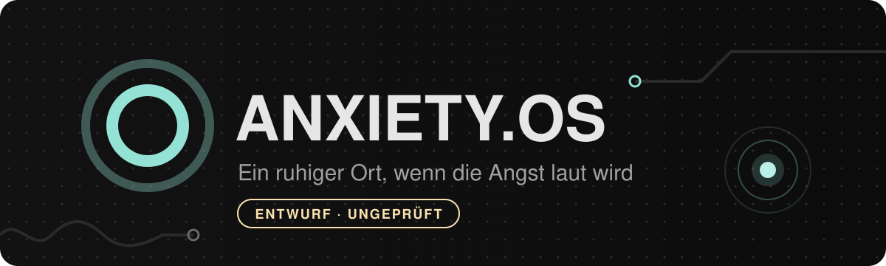

<p align="center">
  
</p>

<p align="center">
  <a href="https://r-winter-mute-dev.github.io/ANXIETY.OS/"></a>
</p>

<p align="center">
  <a href="https://github.com/r-winter-mute-dev/ANXIETY.OS/actions/workflows/pages.yml"></a>
  <a href="https://github.com/r-winter-mute-dev/ANXIETY.OS/actions/workflows/ci.yml"></a>
  
  
  
  
  
</p>

<p align="center">
  <em>Diese App wurde gebaut, damit niemand in einem Moment starker Angst allein mit seinen Gedanken bleiben muss:<br>kurze, ruhige Schritte, jederzeit abbrechbar, ohne dass etwas gespeichert wird.</em>
</p>

---

> [!WARNING]
> **Entwurf, nicht fachlich geprüft.** Die Inhalte wurden noch nicht von Fachpersonal gegengelesen. ANXIETY.OS stellt keine Diagnose, behandelt keine Erkrankung und ersetzt keine ärztliche oder psychotherapeutische Hilfe. Ob die App in akuten Situationen hilft, ist noch nicht untersucht.
>
> **Im Notfall: 112.** Zum Reden in einer Krise: TelefonSeelsorge **0800 111 0 111**, **0800 111 0 222** oder **116 123**, kostenlos und rund um die Uhr.

**ANXIETY.OS** ist ein ruhiger Ort im Browser für Momente, in denen die Angst überhand nimmt. Hier darfst du sein: Du musst nichts lösen, nichts beweisen und nichts aufschreiben. Die App hilft dir, zu sortieren, was gerade da ist, und bietet dir dann einen kleinen nächsten Schritt an.

Die Übungen beruhen auf Prinzipien der kognitiven Verhaltenstherapie, der am besten untersuchten Behandlung bei Angststörungen.

## So funktioniert die App

| | |
| --- | --- |
| **Ein Schritt pro Bildschirm** | Eine Frage oder eine Anweisung, ein großer Knopf. Nichts, worüber du nachdenken musst. |
| **Alles per Antippen** | Auch beim Gedankenprüfen. Eigener Text ist erlaubt, aber nie nötig. |
| **Du entscheidest** | Jede Übung ist freiwillig, jederzeit abbrechbar und hat kein Zeitlimit. |
| **Ein ruhiger Ort** | Dunkle, gedämpfte Farben mit einem leisen violetten Schimmer und einer gezeichneten Szene, die sich langsam bewegt. Sprache, die erlaubt statt anweist. Keine Nummernflut. Bei reduzierter Bewegung steht die Szene still. |
| **Hilfe immer erreichbar** | Oben auf jedem Bildschirm führt ein leiser Link „Hilfe“ zu einer eigenen Seite mit allen Diensten: Notfall sichtbar, alles andere aufklappbar. |
| **Keine Überraschungen** | Keine Töne, keine plötzlichen Bewegungen. Wer im System oder in der App reduzierte Bewegung einstellt, sieht die Atemhilfe ohne Animation. |
| **Auch ohne Netz** | Nach dem ersten Aufruf läuft die App offline und lässt sich wie eine App auf den Startbildschirm legen. |
| **Kein Konto, kein Tracking** | Deine Eingaben sind beim Beenden weg. Gespeichert wird nur, wenn du die Darstellung anpasst. |
| **Anpassbar** | Schriftgröße, Zeilenabstand, Bewegung und Farben (dunkel: Catppuccin Mocha, hell: Catppuccin Latte). |
| **Direkt loslegen** | Unter „Oder einfach etwas tun“ starten Übungen ohne jede Frage. |
| **In Ruhe üben** | Unter „Angst verstehen“ lassen sich alle Übungen ohne Einschätzung vorher und nachher ausprobieren. |

## Ablauf

| Phase | Was passiert |
| :---: | --- |
| 1 | **Ankommen:** „Hier darfst du sein.“ Keine Notfallfrage, keine Skala. |
| 1a | **Eine kleine Reise** (freiwillig, etwa eine Minute): vier Stationen zu einem ruhigen Ort – eine schwebende Insel, eine Brücke aus Glas, eine stille Stadt, ein Baum aus Kristall. Die Szene im Hintergrund rückt mit jeder Station näher, das Leuchten wird wärmer. Jederzeit überspringbar. |
| 2 | **Sortieren: Was ist gerade da?** Körper, Gedanken, ein zu großes Gefühl, alles durcheinander oder „weiß nicht genau“. |
| 3 | **Anerkennen:** ein Satz, der sagt, dass das da sein darf, dann zwei kleine nächste Schritte zur Auswahl |
| 4 | **Eine Übung**, oder eine andere deiner Wahl |
| 5 | **Kurzer Halt:** keine Bewertung. Wenn es schlimmer geworden ist, zeigt die App den Weg zur Hilfe. |

Wer an Suizid denkt, kann das auf der Startseite direkt auswählen und kommt zu einer ruhigen Seite mit der TelefonSeelsorge und der 112.

## Module

| Modul | Worum es geht | Stand |
| --- | --- | :---: |
| **Körpersignale verstehen** | Die App fragt, was du spürst, und erklärt jedes Symptom einzeln: wie Angst es auslöst und wann du Hilfe holen solltest. Nach jedem Signal kurze Nachfrage. Brustschmerz immer zuerst, mit 112. | ✅ |
| **Gedanken prüfen** | Den lautesten Gedanken auswählen und mit vier Fragen prüfen. Am Ende steht eine ausgewogenere Sicht, kein „positives Denken“. | ✅ |
| **Im Raum ankommen** | Aufmerksamkeit nach außen lenken: Umgebung, Geräusche, Kontaktpunkte oder 5-4-3-2-1 | ✅ |
| **Ein einfacher Schritt** | Für den Moment, in dem alles zu viel ist: vier kurze Sätze, mehr nicht | ✅ |
| **Sanfte Atemhilfe** | Freiwillig, nicht tiefer als sonst, ohne Atempausen | ✅ |
| **Angst verstehen** | Kurze Erklärungen zum Angstkreislauf, für ruhigere Momente | ✅ |
| **Vorbereitungsmodus** | Übungen in Ruhe ausprobieren, eigenen Notfallplan anlegen | 🚧 |
| **Tagebuch** | Freiwillig, nur auf deinem Gerät, mit Export und Löschen | 🚧 |

✅ nutzbar, als Entwurf · 🚧 geplant, Details in der [ROADMAP.md](ROADMAP.md)

## Fachliche Prüfung

Bevor ANXIETY.OS öffentlich empfohlen wird, muss eine Fachperson aus Psychotherapie oder Psychiatrie jeden Text gegenlesen. Dafür gibt es die Prüfliste **[REVIEW.md](REVIEW.md)**: Sie zeigt jeden einzelnen Textbaustein mit seinem Status, den Rückfragen aus der Entwicklung und den zugehörigen Quellen.

**Stand: 0 von 241 Einträgen freigegeben.**

Damit nichts versehentlich ungeprüft veröffentlicht wird:

- Das Banner „Entwurf, nicht fachlich geprüft“ lässt sich in der App nicht schließen. Es verschwindet erst, wenn alles freigegeben ist.
- Der Release-Build bricht ab, solange auch nur ein Eintrag ungeprüft ist.

Am meisten hilft gerade:

- [ ] **Fachliches Review** durch Psychotherapeutinnen, Psychotherapeuten oder Psychiaterinnen und Psychiater
- [ ] **Kardiologisches Review** der Körpersignale, damit die App auch Menschen nach einem Herzereignis sicher begleiten kann
- [ ] **Rückmeldung von Menschen mit Angsterfahrung:** Ist etwas zu viel, zu wenig oder unpassend formuliert?
- [ ] **Juristische Einschätzung**, ob die App unter die Medizinprodukte-Verordnung (MDR) fällt
- [ ] **Hosting bei einem Anbieter in der EU** für die spätere Veröffentlichung

Alle offenen Punkte, fehlenden Funktionen und nächsten Schritte stehen in der **[ROADMAP.md](ROADMAP.md)**. Hinweise gern als [Issue](https://github.com/r-winter-mute-dev/ANXIETY.OS/issues).

## Bewusste Entscheidungen

Einige Stellen weichen vom ursprünglichen Konzept ab. Die Fachperson soll sie gezielt prüfen.

| Konzept | Umsetzung | Warum |
| --- | --- | --- |
| Sicherheitsprüfung (Phase 1) und Angst-Skala (Phase 2, 5) | **Ankommen und Sortieren statt Triage.** Warnzeichen stehen auf der Hilfe-Seite und bei den passenden Körpersignalen (Brustschmerz zuerst mit 112). Suizidgedanken sind eine eigene, ruhige Auswahl. | Entscheidung des Projektinhabers: Die App soll sich wie ein sicherer Ort anfühlen. Eine Notfallfrage vorneweg traf auf viele normale Panikattacken zu und schickte Menschen sofort zu Notrufnummern. **Muss fachlich bestätigt werden.** |
| Texteingabe beim Gedankenprüfen | **Alles per Antippen**, Text optional | Bei starker Angst ist Schreiben oft kaum möglich. |
| Atemübung als gleichwertige Option | **An letzter Stelle** in der Übungsliste | Die Evidenz für Atemübungen bei Angst ist schwach (WHO 2023: bedingte Empfehlung). |
| Körperfokus → Aufmerksamkeit nach außen (6.1) | **Körpersignale einzeln erklären**, Grounding danach als Angebot | Wunsch des Projektinhabers. Psychoedukation über Körpersymptome senkt Angstsensitivität, die Studien dazu fanden aber in ruhigem Zustand statt. Für den Einsatz während einer Attacke gibt es keine Studien. Deshalb nur ein Durchgang, Warnzeichen ohne Krankheitsnamen, Ausweg bei „stärker“. |
| Notfall-Knopf auf jedem Bildschirm | **Leiser Link „Hilfe“** oben, alle Dienste auf einer eigenen Seite | Viele Nummern auf einmal wirken bei Angst überfordernd. Die 112 bleibt auf der Hilfe-Seite deutlich sichtbar, alles andere ist aufklappbar. |

## Entstehung

> [!NOTE]
> Diese App entsteht mit Unterstützung von **Claude**, einer KI von Anthropic. Die KI ist für dieses Projekt verändert und auf wissenschaftliches Arbeiten ausgelegt.

- **Belege zuerst:** Fakten stützen sich bevorzugt auf Leitlinien, systematische Reviews und begutachtete Studien. Foren, Blogs und soziale Medien gelten nicht als Beleg.
- **Kennzeichnung:** Jeder Text ist als Entwurf markiert, bis eine Fachperson ihn freigegeben hat. Fachliche Unsicherheiten stehen als Rückfrage in der Prüfliste.
- **Psychologie:** Der Aufbau folgt dem kognitiven Modell der Panik (Clark, 1986) und den Gestaltungsregeln aus dem Konzept: wenig Information pro Bildschirm, keine Pflichtfelder, keine Zeitlimits. Dass die Übungen in dieser kurzen digitalen Form wirken, ist eine begründete Übertragung, kein Nachweis.

Die Idee, die Ziele und die Entscheidungen kommen von einem Menschen. Texte und Code schreibt die KI, ein Mensch prüft sie und gibt sie frei. Auch so können Fehler drinstecken. Wenn dir etwas falsch vorkommt, [öffne ein Issue](https://github.com/r-winter-mute-dev/ANXIETY.OS/issues). Hinweise mit Quelle helfen am meisten.

## Datenschutz

| | |
| --- | --- |
| **Eingaben werden nicht gespeichert** | Keine Cookies, kein Konto. Was du in den Übungen eingibst, existiert nur, solange der Tab offen ist. |
| **Einzige Ausnahme: Darstellung** | Änderst du Schriftgröße, Zeilenabstand, Bewegung oder Farben, merkt sich der Browser diese Auswahl lokal (`localStorage`). Sie verlässt das Gerät nicht. „Zurücksetzen“ löscht sie, bei Standardwerten wird nichts gespeichert. |
| **Keine Drittanbieter** | Keine Schriften von außen, keine CDNs, keine Analyse-Dienste. Ein automatischer Test stellt sicher, dass keine fremden Server angefragt werden. |
| **Hosting** | Zurzeit GitHub Pages. GitHub erhebt beim Aufruf technische Zugriffsdaten wie die IP-Adresse. Für die spätere Veröffentlichung ist ein Hoster in der EU geplant. |

## Fachliche Grundlagen

- Clark, D. M. (1986). A cognitive approach to panic. *Behaviour Research and Therapy*, 24(4), 461–470. [DOI](https://doi.org/10.1016/0005-7967(86)90011-2)
- WHO (2023). [mhGAP guideline for mental, neurological and substance use disorders](https://www.who.int/publications/i/item/9789240084278)
- WHO (2026). [Psychological self-help interventions](https://www.who.int/publications/i/item/9789240120785)
- NICE (2011, aktualisiert 2019). [Generalised anxiety disorder and panic disorder in adults: management (CG113)](https://www.nice.org.uk/guidance/cg113)
- Bandelow, B. et al. (2021). [The German Guidelines for the treatment of anxiety disorders: first revision](https://pmc.ncbi.nlm.nih.gov/articles/PMC8490968/)
- Guth, M., Wiebe, A., Philipsen, A. (2023). [Digitale Gesundheitsanwendungen mit psychotherapeutischem Fokus](https://doi.org/10.1007/s00115-023-01446-y). *Der Nervenarzt*, 94(3), 250–261.

Notrufnummern geprüft am 04.11.2026 bei [116117.de](https://www.116117.de/de/aerztlicher-bereitschaftsdienst.php) und der [TelefonSeelsorge](https://www.telefonseelsorge.de/telefon/).

## Für Entwickler

<details>
<summary><strong>Lokal starten</strong></summary>

Voraussetzung: Node.js 22 oder neuer.

```bash
npm install
npm run dev
```

Die App läuft dann unter http://localhost:5173.
</details>

<details>
<summary><strong>Tests und Prüfliste</strong></summary>

```bash
npm test               # Inhalte und Ablauflogik
npm run test:e2e       # Build, Ende-zu-Ende- und Barrierefreiheitstests (WCAG 2.2 AA)
npm run check          # Typprüfung
npm run review         # REVIEW.md neu erzeugen
npm run build:release  # bricht ab, solange nicht alles freigegeben ist
```

Freigegeben wird direkt im jeweiligen Textbaustein in `src/content/de/*.json`:

```json
"review": { "status": "approved", "reviewer": "Name, Qualifikation", "date": "2026-12-01", "comment": null }
```

Für Änderungswünsche `"status": "changes_requested"` und den Wunsch in `comment`.
</details>

<details>
<summary><strong>Technik</strong></summary>

Statische Web-App mit [Svelte 5](https://svelte.dev), TypeScript und [Vite](https://vite.dev), ohne Server und ohne externe Dienste. Alle Texte liegen getrennt vom Code in `src/content/`, damit sie vollständig geprüft werden können. Die Ablauflogik steht in `src/lib/routes.ts`, jeder Bildschirm ist eine Datei in `src/screens/`. Ein eigener, kleiner Service Worker macht die App offline-fähig. Die Seite wird über GitHub Actions automatisch auf GitHub Pages veröffentlicht.
</details>

<details>
<summary><strong>Eigene Kopie betreiben</strong></summary>

Repository forken, unter **Settings → Pages** als Quelle **GitHub Actions** wählen, fertig. Der Workflow setzt den Pfad der Seite selbst.
</details>

## Lizenz

| Was | Lizenz |
| --- | --- |
| Code | [MIT](LICENSE): frei nutzbar, auch kommerziell, Copyright-Hinweis bleibt erhalten |
| Inhalte (`src/content/`), Dokumentation, Grafiken | [CC BY 4.0](LICENSE-CONTENT): frei nutzbar mit Namensnennung; Änderungen müssen kenntlich gemacht werden |
| Zitierte Studien und Leitlinien | bei den jeweiligen Rechteinhabern; im Projekt stehen nur bibliografische Angaben |
| Farben | [Catppuccin](https://catppuccin.com) Mocha und Latte (MIT) |
| Schrift | Systemschriften des Geräts, keine eingebundenen Schriftdateien |

> [!IMPORTANT]
> Die Inhalte sind ein Entwurf und nicht fachlich geprüft. Wer sie weiterverwendet, macht Änderungen bitte kenntlich und erweckt nicht den Eindruck, eine veränderte Fassung sei geprüft. Versionen bis 0.2.0 waren unter CC0 1.0 veröffentlicht und bleiben es.
